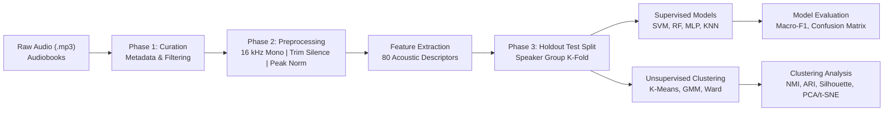

# 🎙️ Iranian Speech Acoustic Analysis: Dialect & Gender Classification

[](https://www.python.org/)
[](https://scikit-learn.org/)
[](https://librosa.org/)
[](https://jupyter.org/)
[](LICENSE)

An end-to-end Machine Learning pipeline for speech processing, acoustic feature extraction, supervised classification, and unsupervised clustering across **5 Iranian dialects** and **speaker genders**.

This project was developed as the Final Project for the graduate-level **Machine Learning Basics** course (Spring 2026) by **Group 2** (focusing on the **Torki / Azerbaijani** dialect alongside benchmark Iranian dialects).

---

## 📑 Table of Contents

- [Overview & Objectives](#-overview--objectives)
- [Pipeline Architecture](#-pipeline-architecture)
- [Project Phases](#-project-phases)
  - [Phase 1: Dataset Collection & Curation](#phase-1-dataset-collection--curation)
  - [Phase 2: Signal Preprocessing & Feature Extraction](#phase-2-signal-preprocessing--feature-extraction)
  - [Phase 3: Classification, Clustering & Evaluation](#phase-3-classification-clustering--evaluation)
- [Experimental Results](#-experimental-results)
  - [Supervised Classification](#1-supervised-classification)
  - [Unsupervised Clustering](#2-unsupervised-clustering)
  - [Key Findings & Acoustic Analysis](#3-key-findings--acoustic-analysis)
- [Repository Structure](#-repository-structure)
- [Installation & Setup](#-installation--setup)
- [How to Run](#-how-to-run)
  - [Using Pre-trained Models](#using-pre-trained-models)
  - [Running the Notebooks](#running-the-notebooks)
- [Team Members & Credits](#-team-members--credits)

---

## 🔍 Overview & Objectives

Human speech contains multi-layered acoustic signatures encoding semantic content, physical speaker traits (such as gender and vocal tract morphology), and regional pronunciation habits (dialects and accents). 

The primary objectives of this project are:
1. **Curate high-quality speech samples** from Persian audiobooks with strict acoustic standards (single speaker, high SNR, zero background music, balanced duration).
2. **Build an automated audio preprocessing and feature extraction pipeline** extracting 80 comprehensive acoustic features (MFCCs, Spectral Contrast, Formants/Pitch $F_0$, Centroid, Bandwidth, Rolloff, ZCR, RMS, Onset Rate).
3. **Train and tune supervised classifiers** (SVM, Random Forest, MLP, KNN) using **Stratified Group K-Fold** cross-validation to prevent speaker identity leakage.
4. **Discover latent acoustic groupings** using unsupervised clustering algorithms (K-Means, Gaussian Mixture Models, Agglomerative Hierarchical Clustering) evaluated with Silhouette scores, NMI, and ARI.
5. **Analyze the acoustic separability** of dialects vs. gender in 2D embedding spaces (PCA and t-SNE).

---

## 🏗️ Pipeline Architecture



---

## 📦 Project Phases

### Phase 1: Dataset Collection & Curation
- **Dialect Focus**: Turkish / Azerbaijani (`Torki`) accented speech in Persian, along with four comparative dialects (**Gilaki**, **Kordi**, **Isfahani**, **Mashhadi**).
- **Audio Sources**: High-fidelity audiobook platforms (*Shenoto*, *Taaghche*, *Fidibo*).
- **Selection Criteria**:
  - Exclusively single-speaker narration (interviews and TV talk shows were rejected).
  - Clean studio-quality recording with high SNR; zero background music and sound effects.
  - Sliced into balanced ~60-second segments (50s–70s range after silence removal).
- **Deliverables**: Detailed dataset metadata catalog (`phase-1/G02_metadata.csv`) with timestamps, cloud storage links, and speaker metadata.

> **Note on Raw Audio**: In line with standard ML open-source practices, large raw audio datasets are intentionally excluded from the repository. The metadata catalog provides cloud storage links to access the original recordings, while the extracted numerical feature matrix (`final_feature_dataset.csv`) is included directly for complete, immediate reproducibility.

### Phase 2: Signal Preprocessing & Feature Extraction
The unified dataset comprises **410 audio recordings** across 5 dialects and both genders:
- **Gilaki**: 111 samples | **Torki**: 108 samples | **Kordi**: 99 samples | **Isfahani**: 60 samples | **Mashhadi**: 32 samples
- **Gender Balance**: 211 Female, 199 Male

#### Preprocessing Steps:
1. **Audio Standardization**: Converted to single-channel (mono) at a target sampling rate of 16 kHz.
2. **Silence Removal**: Trimmed leading and trailing non-speech silences using `librosa.effects.trim` with a `top_db=25` threshold.
3. **Peak Normalization**: Scaled amplitude to a peak target of 0.95 to eliminate volume differences across recording setups.
4. **Quality Assurance Filter**: Automated screening for abnormal durations, very low energy (RMS $< 0.02$), and high-frequency noise anomalies.

#### Extracted Acoustic Features (80 numerical features):
| Category | Features Extracted | Count | Acoustic Significance |
| :--- | :--- | :---: | :--- |
| **Timbre & Vocal Tract** | MFCCs 1–13 ($\mu, \sigma$) | 26 | Spectral envelope capturing shape of vocal tract |
| **Spectral Dynamics** | Delta-MFCCs 1–13 ($\mu, \sigma$) | 26 | First-order temporal derivatives of MFCCs |
| **Spectral Contrast** | Contrast Bands 1–6 ($\mu, \sigma$) | 12 | Energy ratio between spectral peaks and valleys |
| **Frequency & Energy** | Spectral Centroid, Bandwidth, Rolloff, Flatness ($\mu, \sigma$) | 8 | Brightness, spread, high-frequency cutoff, and noisiness |
| **Prosody & Pitch** | Fundamental Frequency $F_0$ ($\mu, \sigma$), Voiced Fraction | 3 | Vocal fold vibration rate (strong gender discriminator) |
| **Temporal & Rhythm** | Zero Crossing Rate ($\mu, \sigma$), RMS Energy ($\mu, \sigma$), Onset Rate | 5 | Voicing transitions, loudness envelope, speaking rhythm |

---

### Phase 3: Classification, Clustering & Evaluation

#### 1. Data Partitioning & Leakage Prevention
To ensure realistic evaluation without data leakage:
- An **Official Test Set** was held out prior to all modeling.
- The remaining data was split using **Stratified Group K-Fold** grouped strictly on `speaker_id`. This prevents recordings from the same speaker appearing in both training and validation splits.

#### 2. Models Evaluated
- **Support Vector Machine (SVM)**: RBF and Linear kernels with standardized inputs (`StandardScaler`).
- **Random Forest (RF)**: Ensemble of decision trees with variance-threshold feature pruning.
- **Multi-Layer Perceptron (MLP)**: Feedforward neural network tuned with Adam optimizer and early stopping.
- **K-Nearest Neighbors (KNN)**: Distance-based classification across Euclidean and Manhattan metrics.
- **Unsupervised Clustering**: K-Means, Gaussian Mixture Models (full covariance), and Agglomerative Hierarchical Clustering (Ward linkage).

---

## 📊 Experimental Results

### 1. Supervised Classification

Validation performance across all trained models (evaluated with macro-averaged metrics):

| Task | Model | Accuracy | Macro-Precision | Macro-Recall | Macro-F1 | Macro-F2 |
| :--- | :--- | :---: | :---: | :---: | :---: | :---: |
| **Gender** | **SVM (Best)** | **88.41%** | **0.8888** | **0.8849** | **0.8838** | **0.8837** |
| Gender | Random Forest | 75.36% | 0.8117 | 0.7567 | 0.7430 | 0.7428 |
| Gender | MLP | 66.67% | 0.7982 | 0.6714 | 0.6289 | 0.6378 |
| Gender | KNN | 62.32% | 0.7061 | 0.6185 | 0.5761 | 0.5877 |
| **Dialect** | **SVM (Best)** | **29.23%** | **0.0990** | **0.2375** | **0.1397** | **0.1855** |
| Dialect | MLP | 15.38% | 0.0928 | 0.1250 | 0.1060 | 0.1165 |
| Dialect | KNN | 10.77% | 0.0583 | 0.0700 | 0.0636 | 0.0673 |
| Dialect | Random Forest | 9.23% | 0.0417 | 0.0750 | 0.0536 | 0.0647 |

---

### 2. Unsupervised Clustering

Clustering evaluated at optimal silhouette cluster count ($k=10$) versus the true dialect count ($k=5$):

| Model | Cluster Selection | $k$ | Silhouette | NMI (Dialect) | ARI (Dialect) | NMI (Gender) | ARI (Gender) |
| :--- | :--- | :---: | :---: | :---: | :---: | :---: | :---: |
| **K-Means** | Silhouette-optimal | 10 | **0.1803** | **0.3848** | **0.1652** | 0.3242 | 0.1620 |
| **GMM** | Silhouette-optimal | 10 | 0.1761 | 0.3760 | 0.1635 | 0.3140 | 0.1557 |
| **Hierarchical (Ward)** | Silhouette-optimal | 10 | 0.1633 | 0.3639 | 0.1543 | 0.3070 | 0.1523 |
| **GMM** | True dialect count | 5 | 0.1418 | **0.2926** | **0.1998** | 0.2766 | 0.1995 |
| **K-Means** | True dialect count | 5 | 0.1468 | 0.2679 | 0.1664 | 0.2101 | 0.1900 |
| **Hierarchical (Ward)** | True dialect count | 5 | 0.1263 | 0.2343 | 0.1190 | 0.2474 | 0.2025 |

---

### 3. Key Findings & Acoustic Analysis

1. **Gender Separation is Strong**: 
   - Achieving **88.41% accuracy**, gender is readily separable via global acoustic features. 
   - Statistical testing confirmed a significant difference in mean pitch: female speakers exhibit significantly higher fundamental frequency ($F_0$) and higher spectral centroid values than male speakers ($p < 10^{-15}$).
2. **Dialect Classification is Challenging**:
   - Dialect differences in standard Persian reading are subtle. Unlike gender, regional accents manifest primarily in **prosodic contours, vowel formant shifts ($F_1, F_2$), and lexical stress patterns** that global statistical summaries (mean/std of MFCCs over 60 seconds) partially blur.
   - Individual speaker acoustic characteristics often outweigh dialectal differences, highlighting the necessity of phoneme-level or sequence-based models (such as HuBERT, Wav2Vec2, or Whisper representations) for fine-grained accent detection.
3. **Unsupervised Discoveries**:
   - Silhouette analysis peaks at $k=10$ rather than $k=5$. This reflects an interaction where clusters jointly capture **(5 dialects $\times$ 2 genders)** sub-spaces, achieving an NMI of **0.3848**.

---

## 📁 Repository Structure

```text
ML-project/
├── .gitignore
├── requirements.txt
├── README.md
│
├── phase-1/                                # Phase 1: Data Collection & Annotation
│   ├── G02_metadata.csv                    # Metadata of collected clips (URLs, duration, speaker)
│   └── report.pdf                          # Phase 1 documentation and source analysis
│
├── phase-2/                                # Phase 2: Cleaning, Preprocessing & Feature Extraction
│   ├── final_feature_dataset.csv           # 410 speech samples × 87 acoustic feature columns
│   ├── phase2.ipynb                        # Preprocessing & feature extraction notebook
│   └── phase2_report.pdf                   # Phase 2 comprehensive technical report
│
└── phase-3/                                # Phase 3: Modeling, Classification & Clustering
    ├── phase3.ipynb                        # Complete training, clustering & visualization notebook
    ├── official_test_filenames_FOR_STUDENTS.csv # Holdout test set partition
    ├── Final_Project_Phase3_Report.pdf     # 40-page final project report
    └── Results/                            # Generated artifacts and evaluation plots
        ├── Classification/                 # Reports, confusion matrices, test predictions
        │   ├── dialect/
        │   └── gender/
        ├── clustering/                     # Silhouette plots, PCA & t-SNE projections
        ├── Final Summary/                  # Narrative summaries & combined benchmark CSVs
        └── saved-models/             # Serialized production models (.joblib) & test features
            ├── dialect_model.joblib
            ├── gender_model.joblib
            ├── clustering_model.joblib
            └── test_features.csv
```

---

## ⚙️ Installation & Setup

### 1. Clone the Repository
```bash
git clone https://github.com/your-username/ML-project.git
cd ML-project
```

### 2. Create and Activate a Virtual Environment
```bash
# On Linux / macOS
python3 -m venv venv
source venv/bin/activate

# On Windows (PowerShell)
python -m venv venv
.\venv\Scripts\Activate.ps1
```

### 3. Install Dependencies
```bash
pip install --upgrade pip
pip install -r requirements.txt
```

> **Note on Audio Backends**: If processing raw `.mp3` files in Phase 2, ensure `ffmpeg` is installed on your system PATH (`pydub` and `soundfile` rely on ffmpeg for MP3 decoding).

---

## 🚀 How to Run

### Using Pre-trained Models
You can directly load and infer using the serialized models without retraining:

```python
import joblib
import pandas as pd

# Load saved pipelines
dialect_model = joblib.load("phase-3/Results/saved-models/dialect_model.joblib")
gender_model = joblib.load("phase-3/Results/saved-models/gender_model.joblib")

# Load sample features (without label columns)
test_data = pd.read_csv("phase-3/Results/saved-models/test_features.csv")
X_test = test_data.drop(columns=["filename"])

# Run inference
predicted_gender = gender_model.predict(X_test)
print("Predicted Genders:", predicted_gender[:5])
```

### Running the Notebooks
1. **Phase 2 (Preprocessing)**: Open `phase-2/phase2.ipynb` to view the audio cleaning, silence trimming, and 80-dimensional feature extraction routines.
2. **Phase 3 (Machine Learning Pipeline)**: Open `phase-3/phase3.ipynb` to run the classification benchmarks, grid search, K-Means / GMM / Ward clustering, and generate PCA/t-SNE plots.

---

## 👥 Team Members & Credits

**Group 2 — Machine Learning Basics (Spring 2026)**
- **Afshin Azizi**
- **Hemo Fatemi**
- **AmirMohammad MohammadHosseini**

**Course Instructors**:
- Dr. Mohammadreza A. Dehghani
- Dr. Mostafa Tavassolipour

**Teaching Assistants**:
- Arash Taherifard
- Amirhossein Aref
- Hamidreza Taleai

---

## 📄 License
This project is open-source and available under the [MIT License](LICENSE).
